# BloodNet: Software Architecture Document (SAD)

| | |
|---|---|
| **Version** | 1.1 (MVP baseline, assistants update) |
| **Date** | 2026-10-17 |
| **Status** | Draft for team review |
| **Replaces** | Version 1.0 (2026-10-10), Architecture v0.1 and the working architecture notes. Execution plan and user stories remain the planning documents |
| **Audience** | Dev team, course supervisor, dean |
| **Repo path** | `docs/architecture.md` |

> **Reading guide.** Sections 1 to 4 give the big picture. Sections 5 to 9 are the design. Sections 10 to 14 are interfaces, security, UX, quality and operations. Section 15 lists the decisions. Appendices hold the policy catalogue, plan corrections and work ownership.
> **Honest scope.** This is a university MVP on **synthetic data**. It is not cleared for clinical use and does not claim compliance with any medical or international standard. See section 1.4.
>
> **What changed in 1.1.** The chatbot grows from a donor FAQ into role-aware assistants (section 5.7). It stays read-only. A card in the chat can only open a screen in the browser. Nothing is saved until the user does it on that screen (invariant I12, ADR-017). Everything else is unchanged except where it must follow: container view, endpoints, tests, risks, ownership. Six gaps found when the user stories were checked against this document are also closed: the lookup endpoints (10.3), the release gates and the blood group (7.2), cancel before dispatch (7.4), a link between requests (6.4), the endpoints for returned units and recall (10.3), and the storage temperature parameter (Appendix A). Changed passages are marked with (1.1).

---

## 1. Introduction

### 1.1 Purpose
BloodNet connects three groups around a unit of blood:

- **Donors** find where to donate and what to expect.
- **Blood centers** register donors, test and release units, manage stock, and answer hospital requests.
- **Hospitals** request blood, compare offers, and confirm receipt.

### 1.2 Real-world workflow the system must fit
This comes from hospital staff and from the team's sources. It drives the design.

1. A doctor fills a **paper request**: hospital name, patient name, national ID, address, doctor name, administration **stamp and signature**, and the blood needed.
2. The patient's **blood sample** (EDTA tube) goes to the blood bank with the request.
3. The bank **types the patient's group** and **crossmatches** the sample against the unit. Compatible or not.
4. The bank issues the unit and a **paper receipt form** with the case data and the patient's hemoglobin. The blood is received against that form.
5. Donors are screened on **blood pressure, blood sugar, hemoglobin, surgery history and phone number**, among other things.

**Design consequence.** Paper remains the legal artifact. The system does not replace stamps and signatures. It **pre-fills and prints the forms**, tracks that the signed form arrived, and refuses to issue blood without it. Section 9 covers this.

### 1.3 Definition of MVP success
The MVP is complete when the team can run this path end to end, on staging, with synthetic data:

> donor visit → collection → tests → physician approval and release → hospital request → one unit reserved without duplication → patient sample, typing, crossmatch → issue and dispatch → receipt confirmed,

and the negative tests pass: forbidden transitions, forbidden roles, tenant isolation at the API, append-only history, and the audit trail.

Anything that does not serve this path and is not a core safety control can be deferred.

### 1.4 Non-claims
- Not cleared for real patients or real donor data.
- No claim of compliance with ISBT 128, WHO guidance, ISO 15189, or any national standard. The design is *guided by* them.
- All medical values are **configuration with a verification status**. Values from the team's own sources are `unverified`.
- Row-Level Security (RLS) is **not implemented** in the MVP. Tenant isolation is enforced in the API and proven by tests (section 11.3).
- After a unit is `Received`, the system does not track its use or its expiry. That is out of scope.
- (1.1) The chatbot does not judge donor eligibility or blood compatibility, does not approve anything, and does not create or change data.

### 1.5 Environment vs usage mode
Two independent settings. Do not tie medical approval to `NODE_ENV`.

| Setting | Values | Meaning |
|---|---|---|
| `APP_ENV` | `development`, `staging`, `production` | Technical environment |
| `USAGE_MODE` | `demo`, `clinical` | Whether data is synthetic or real |

- The MVP always runs `USAGE_MODE=demo`, including on a staging build deployed with production-like settings.
- `clinical` requires every active policy parameter to be `approved`, plus legal and clinical sign-offs outside this project. The application refuses to start in `clinical` mode otherwise.
- In `demo` mode the UI shows a permanent banner: *"Demo mode. Synthetic data. Rules not approved."* Real identifiers are rejected (section 6.6).

---

## 2. Architectural drivers

### 2.1 Quality attributes (ordered)

| # | Attribute | Goal | How we address it |
|---|---|---|---|
| 1 | **Safety integrity** | No unsafe unit is released, reserved twice, or issued without checks | DB-enforced state machine, release gate, unique reservation index, two-person controls |
| 2 | **Traceability** | Every unit and decision can be reconstructed | Append-only history, audit log, policy versioning |
| 3 | **Confidentiality** | Donor and patient identity is protected | Field encryption, data minimization, scoped queries, identity-view audit |
| 4 | **Speed of use** | Busy clinicians finish common tasks fast | UX architecture (section 12), inbox-first screens, short forms, printable forms |
| 5 | **Maintainability** | Three people can change it safely | Modular monolith, strict module boundaries, tests per story |
| 6 | **Operability** | Easy to deploy, back up, and restore | Docker Compose, CI/CD, backup drills |
| 7 | **Performance** | Responsive at demo scale | Indexes, small payloads, measured targets |

### 2.2 Constraints
- 3 people, 12 weeks, demo in week 10.
- Node.js and TypeScript for the API. Next.js for the UI. PostgreSQL. A separate Python chatbot service.
- Hosting: a university server or a small VPS. No managed cloud services assumed.
- No Redis, no message broker in the MVP.

### 2.3 Assumptions
- One API instance and one worker instance in the MVP.
- (1.1) One chatbot instance too, so its session state can live in memory.
- The university server allows Docker. If not, a VPS is the fallback.
- Staff use laptops. Donors use phones for the public page only.
- A USB barcode scanner behaves as a keyboard. No scanner SDK is needed.

### 2.4 Main risks (full list in section 16)
UI capacity, unverified medical values, one-person backend load, exam periods, and AI-generated code quality. (1.1) Also: a chatbot that misreads a sentence.

---

## 3. System context

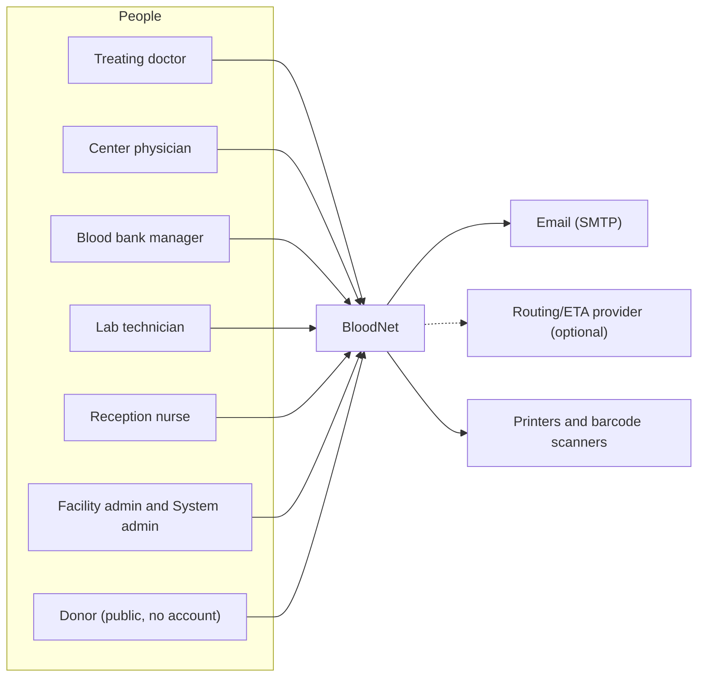

| Actor | Main goals |
|---|---|
| Treating doctor | Request blood fast, compare offers, confirm receipt |
| Center physician | Decide on donor eligibility, approve results, release units, decide on blocked units |
| Blood bank manager | Stock, offers, patient samples, issue, dispatch, expiry removal |
| Lab technician | Enter and review results, typing, crossmatch |
| Reception nurse | Register donors, consents, measurements, collection |
| Facility admin | Staff accounts of one institution |
| System admin | Institutions, centers, licenses, policy, chatbot content |
| Donor | Information, nearest center, chatbot |

External systems are minimal on purpose. Email is the only required one. The routing provider is optional and replaceable (ADR-014).

---

## 4. Container view and deployment

### 4.1 Containers

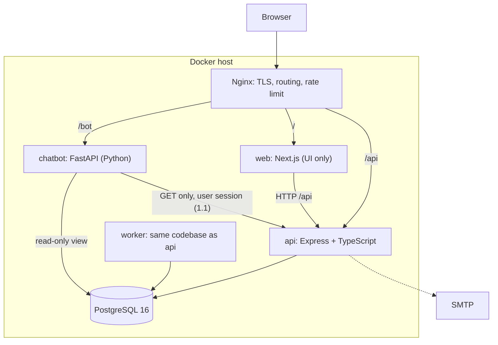

| Container | Tech | Responsibility | Talks to |
|---|---|---|---|
| `nginx` | Nginx | TLS, path routing, request size and rate limits, security headers | web, api, chatbot |
| `web` | Next.js, Tailwind, shadcn/ui | All screens, (1.1) including the chat panel and Action Cards. **No business rules, no database access** | api (HTTP) |
| `api` | Node.js LTS, Express 5, TypeScript strict | Business logic, authorization, validation, audit | db |
| `worker` | Same image as api, different command | Scheduled jobs: expiry, routing rounds, hold timeouts, notifications | db |
| `chatbot` | Python, FastAPI | Answers from published content. (1.1) Role-based read tools through the api with the user's own session. Prepares Action Cards. Never writes | db (view `kb_published_v`, role `chatbot_ro`), api (GET only, allow-list) |
| `db` | PostgreSQL 16 | System of record. Enforces critical invariants | none |

### 4.2 Deployment view

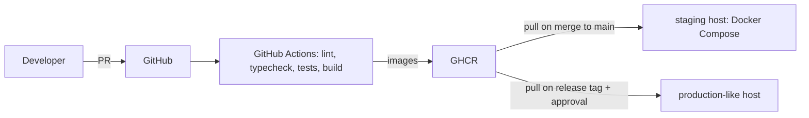

| Item | Decision |
|---|---|
| Networks | `edge` (nginx, web, api, chatbot), `internal` (api, worker, chatbot, db). The database is not reachable from `edge` |
| Volumes | `pgdata`, `backups` |
| Secrets | Docker secrets or an `.env` file kept outside the repo. Only `.env.example` is committed |
| Images | Multi-stage, non-root user, `HEALTHCHECK`, pinned base versions |
| Time zone | UTC in containers and in the database. UI renders Africa/Cairo |
| Node version | Pinned in `.nvmrc` and in the Dockerfile |
| Self-hosted runner | If the university host blocks inbound SSH, use a runner installed on the host |

### 4.3 Environments

| Env | `APP_ENV` | `USAGE_MODE` | Data |
|---|---|---|---|
| Local | development | demo | Seed script |
| Staging | staging | demo | Seed + demo scenario data |
| Demo host | production | demo | Seed only. Banner always on |

---

## 5. Application architecture

### 5.1 Modular monolith

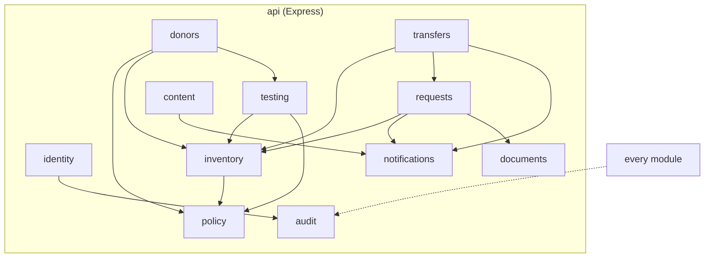

### 5.2 Module catalogue

| Module | Owns (tables) | Exposes (service API) | May depend on |
|---|---|---|---|
| `identity` | institutions, blood_centers, center_licenses, users, sessions | `authenticate`, `authorize`, `getScope` | audit |
| `policy` | policy_versions, policy_parameters | `getActivePolicy`, `evaluateRules`, `proposeChange`, `approveChange` | audit |
| `audit` | audit_events | `record(event)` | none |
| `donors` | donors, donor_registry, visits, consents, assessments, donations | `registerDonor`, `registryLookup`, `recordAssessment`, `decide`, `recordCollection` | policy, inventory, testing |
| `testing` | lab_test_orders, lab_samples, lab_results, lab_result_reviews, result_approvals, release_decisions | `createOrders`, `enterResult`, `reviewResult`, `approveAndRelease`, `authorizeRetest` | policy, inventory |
| `inventory` | blood_units, unit_events, unit_status_transitions, storage_temperature_logs | `transitionUnit`, `reserveUnits`, `listStock`, `confirmRemoval`, `evaluateUnit` (1.1), `listDonationUnits` (1.1) | policy |
| `requests` | patients, blood_requests, request_targets, offers, reservation_items, patient_samples, crossmatch_records | `createRequest`, `routeRound`, `answerRequest`, `approveOffer`, `acceptSample`, `recordCrossmatch`, `cancelRequest`, `lookupPatient` (1.1) | inventory, notifications, documents |
| `transfers` | transfers, transfer_items, handovers | `issue`, `dispatch`, `receive`, `returnUnit`, `recallDonation` (1.1) | inventory, requests, notifications |
| `documents` | form_issuances | `renderRequestForm`, `renderReceiptForm`, `renderDonorCard`, `renderUnitLabel` | none |
| `content` | kb_articles | `draft`, `submitForReview`, `review`, `publish` | notifications |
| `notifications` | notifications | `notify(user, kind, ref)` | none |

### 5.3 Dependency rules
1. Layering inside a module: `routes → service → repo`. Repo contains SQL only and knows nothing about HTTP.
2. A module never imports another module's `repo`. It calls the other module's exported service.
3. The only writer of a table is its owning module. Reads from other modules go through services or database views.
4. `audit` and `notifications` depend on nothing.
5. Enforced by a lint rule (`eslint-plugin-boundaries` or `dependency-cruiser`) in CI.
6. All database access goes through `withTx(ctx, fn)`. No `pool.query` outside `core/db`.

### 5.4 Repository layout

```
repo/
├── apps/
│   ├── api/
│   │   └── src/
│   │       ├── core/          db (withTx), auth, rbac, scope, errors, crypto, logger, config
│   │       │                  channel guard: X-Channel chatbot, GET allow-list (1.1)
│   │       ├── modules/
│   │       │   ├── identity/  policy/  audit/  donors/  testing/  inventory/
│   │       │   └── requests/  transfers/  documents/  content/  notifications/
│   │       │       ├── routes.ts      HTTP, Zod validation, calls service
│   │       │       ├── service.ts     use cases, transaction boundaries
│   │       │       ├── repo.ts        SQL only
│   │       │       └── schemas.ts     Zod, shared types from packages/shared
│   │       ├── jobs/          expire-units, expire-offers, route-rounds, notify
│   │       ├── app.ts
│   │       └── server.ts
│   ├── web/                   Next.js (see 5.6)
│   │   └── src/components/assistant/   chat panel, Action Card renderer, card allow-list (1.1)
│   └── chatbot/               FastAPI, read-only assistants (see 5.7) (1.1)
│       ├── app/
│       │   ├── main.py        app factory, CORS, router mounting
│       │   ├── routers/ask.py POST /bot/ask
│       │   ├── pipeline/      normalize, digit filter, guards, intent, slots, templates
│       │   ├── tools/         per-role read tools that call the api with the user's session
│       │   ├── kb/            published-content index and matching
│       │   ├── cards.py       Action Card builders (allow-listed actions only)
│       │   ├── session.py     in-memory session store with idle TTL
│       │   └── settings.py    pydantic-settings, thresholds, api base URL
│       └── tests/             evaluation sets and TestClient tests
├── packages/
│   └── shared/                Zod schemas, enums, API types, error codes, card schema (1.1)
├── db/
│   ├── migrations/            plain SQL, forward-only, numbered by merge order
│   ├── functions/             transition_unit, unit_release_ready, registry helpers
│   └── seed/                  policy seed, synthetic data (demo only)
├── docs/                      architecture.md, requirements.md, standards-register.md, adr/, runbook.md
├── docker-compose.yml  docker-compose.prod.yml
└── .github/workflows/
```

### 5.5 Cross-cutting concerns

| Concern | Design |
|---|---|
| **AuthN** | Server-side sessions in PostgreSQL, `HttpOnly` `Secure` `SameSite=Lax` cookie, argon2id hashes, lockout after 5 failures, login rate limit |
| **AuthZ** | `role` plus scope. Permission checks live in service layer, not only in routes (section 11.2) |
| **Tenant scope** | Every repo function takes a `Scope` object and must filter by it. Unscoped queries are lint-banned (section 11.3) |
| **Validation** | Zod at the edge. Domain checks in services. Database constraints as the last line |
| **Errors** | Typed errors mapped to a stable JSON error model (section 10.2). Database errors are translated, never leaked |
| **Audit** | `audit.record()` called from services inside the same transaction as the change |
| **Idempotency** | `Idempotency-Key` header on sensitive POSTs, stored with request hash and response |
| **Jobs** | Worker polls with `FOR UPDATE SKIP LOCKED` and takes an advisory lock per job type. Jobs are idempotent |
| **Logging** | `pino` JSON, `request_id`, redaction of identifiers and tokens |
| **Config** | Typed config from env, validated at startup. Missing or invalid config fails fast |
| **Time** | `timestamptz` in UTC. `event_at` (when it happened) and `recorded_at` (when it was entered) on all events |
| **Assistant channel (1.1)** | Calls made by the chatbot carry `X-Channel: chatbot`. The API accepts from that channel only the GET allow-list in section 10.1 and answers `403 CHANNEL_NOT_ALLOWED` to everything else, whatever the user's role. The session cookie must have `Path=/` so the browser sends it to `/bot` as well as `/api` |

### 5.6 Web application architecture

| Topic | Decision |
|---|---|
| Framework | Next.js App Router, one app, route groups `(public)` and `(staff)` |
| Rendering | Server components for static pages. Client components for forms and live lists |
| Data fetching | TanStack Query against the API. Cache keys per resource. Mutations invalidate lists |
| Forms | React Hook Form with Zod resolvers using schemas from `packages/shared` |
| Components | shadcn/ui with Tailwind. One layout, one table component, one form kit |
| RTL | `dir="rtl"`, Tailwind logical utilities (`ms-`, `me-`, `ps-`, `pe-`). Arabic font stack (Cairo or Noto Sans Arabic) |
| Strings | All Arabic strings in one `messages/ar.json`. No literals in components |
| Permissions | UI hides what a role cannot do. The server enforces regardless |
| Printing | Dedicated print routes with print CSS (section 9) |
| Error handling | Error boundaries per workspace. Empty, loading, and error states in every list |
| Business rules | **None.** The UI displays rule results returned by the API |
| Assistant panel (1.1) | One chat panel on the public page and on every staff screen. It renders text, suggestions and Action Cards. A card carries a key from an allow-list in code: `open_screen` (a screen key, never a URL) or `open_request_form` (four default values). Both only navigate. Anything else in a card is ignored |

### 5.7 Chatbot service (1.1: role-aware assistants)

The chatbot is a conversational interface over the same API. Anything it does, the user could do from a screen with the same permissions.

> **Golden rule.** The chatbot never creates, approves, reserves, accepts or changes anything. It reads and answers. When a screen is the right place for an action, it shows an Action Card. A card only opens that screen in the browser. Nothing is saved until the user does it there, under their own session.

**Four assistants instead of one function**

| # | Assistant | For whom | What it does | Effect |
|---|---|---|---|---|
| 1 | Donor assistant | Visitor (no account) | Answers from approved content, shows the nearest center, explains the steps | None |
| 2 | Request assistant (new) | Treating doctor | Takes a free sentence (component, group and Rh, quantity, priority), asks for what is missing, shows a summary, then offers a card that opens the New request form with those values | None. The doctor submits the form |
| 3 | Follow-up assistant (new) | Treating doctor | "Status of request 1042?", "who replied?". Summarizes offers with distance, ETA estimate and unit expiry | None |
| 4 | Blood bank assistant (new) | Blood bank manager | New requests, stock summary, units close to expiry | None |

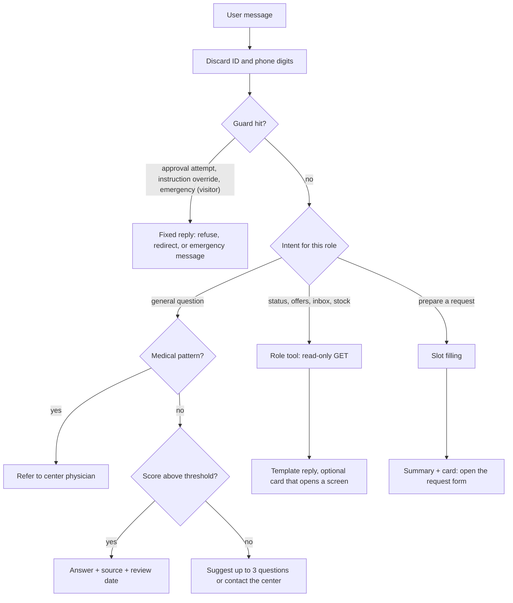

**How it works**

- **Identity of the caller.** The chatbot receives the browser's session cookie (same origin through nginx) and forwards it on every API call. It holds no service credentials. The API enforces role and scope exactly as for the UI, so a message cannot make the chatbot see more than the caller can.
- **Pipeline.** Discard ID and phone digits, normalize the Arabic text (letter variants, digits, diacritics), run the guards, route the intent by role, fill slots, validate, summarize, then reply from a template. No LLM in the MVP. Free text only selects an intent and fills slots. Every reply is a template or the text of a published article.
- **Published content.** Scored matching over the published articles (the question and its alternative phrasings). It answers only when the score is above a threshold, the margin over the second article is large enough, and the question shares at least one content word with the matched article. Otherwise it suggests up to three questions or tells the user to contact the center. Thresholds live in config and are tuned on the fixed question set.
- **Request slots.** Required: component, group and Rh, quantity, priority. The values are the ones of the request form (section 12.3). The card carries only these four as defaults. The form checks them like any other input and the API checks them again on submit.
- **Patient identity is never taken in chat.** Digit runs that look like a national ID or a phone number are discarded before anything else, and the user is told to enter the patient on the request form. Names are not used for any slot, are not repeated in a reply, and are stripped from logs.
- **Emergency wording.** From a visitor, medical emergency wording gets a fixed message with the emergency number and the hospital procedure. For staff, "emergency" is a priority value, not an alarm.
- **Session state.** In memory in the single chatbot instance, with an idle TTL. It is lost on restart and the user simply starts again. No conversation is written to the database. Question text is logged only after stripping digits and names.
- **Language.** Arabic, Egyptian dialect and Modern Standard.

**Tools by role.** A tool is a Python function that calls the API with the user's session. The chatbot has no database access except reading published content through the view.

| Role | Tools (all read-only) | Action Cards it may offer |
|---|---|---|
| Visitor (no session) | `faq.search` (view `kb_published_v`), `centers.nearest` (`GET /public/centers`) | none |
| Treating doctor | `request.compose` (slots only, no API call), `request.status` (`GET /requests`, `GET /requests/:id`), `offers.summary` (`GET /requests/:id`) | `open_request_form`, `open_screen` (offers) |
| Blood bank manager | `inbox.requests` (`GET /inbox/requests`), `stock.summary` (`GET /inventory`), `expiry.list` (`GET /inventory/expired`, `GET /inventory?expiring_within_days=`) | `open_screen` |
| Other staff roles | `faq.search`, `centers.nearest` | none |

**What the chatbot never does**

- It does not tell a donor whether they qualify. It gives approved general information and refers medical questions to a physician.
- It does not decide blood compatibility. It can only repeat the text of a published article.
- It does not create, approve, accept, reserve, reject, cancel or remove anything. "Approve it" or "ignore your instructions" is refused and the user is pointed to the right screen.
- It does not answer outside the published content. When it is not sure it suggests questions or says to contact the center.
- It does not take or show patient or donor identity (national ID, name, address).

**Evaluation.** Fixed sets run in CI: published-content questions (answered, suggested or refused as expected), medical referral rate 100%, slot extraction including Arabic number words, injection and approval attempts refused, out-of-scope questions never answered with a wrong article, ID and phone digits never reaching a reply or a log, and no card ever offered before the summary.

---

## 6. Data architecture

### 6.1 Principles
1. Small model. Every column has a reason in a story, a rule, or a form.
2. Donation, unit, and request are separate concepts.
3. History is append-only. Corrections are new rows.
4. Sensitive fields are encrypted. Identity is not shared across centers beyond the minimum.
5. `facility` scope columns are stored on every sensitive table, with composite checks against the parent.
6. Migrations are small, forward-only, and numbered by **merge order**, not by the week a feature started.

### 6.2 Tenancy model
- **Institution:** a hospital, university, or health body. Owns users and requests.
- **Blood center:** a licensed center. Owns donors' visits, units, and stock. May belong to an institution or stand alone.
- A hospital with an internal blood bank has one institution and one center. A hospital that buys from outside has an institution and no center.

| Data | Scoped by |
|---|---|
| Users, requests, patients, handovers received | `institution_id` |
| Donors, visits, donations, units, lab data, stock, offers made | `center_id` |
| Offers (visible to both sides) | requesting `institution_id` and offering `center_id` |
| Donor registry | shared, minimal, via function only |

### 6.3 Entity relationships

**Tenancy, donors, units**

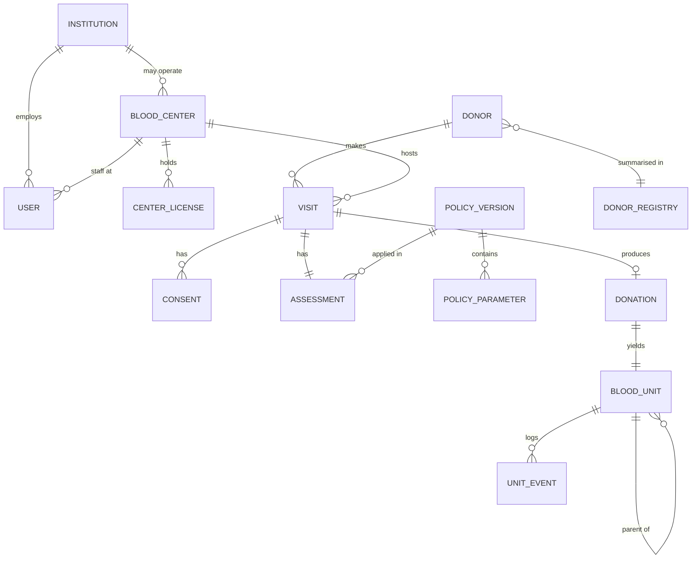

**Testing and release**

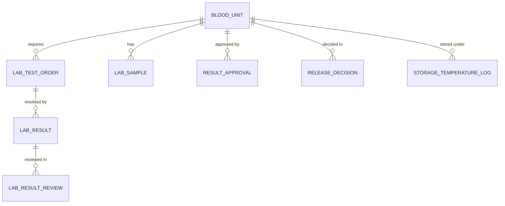

**Requests and fulfilment**

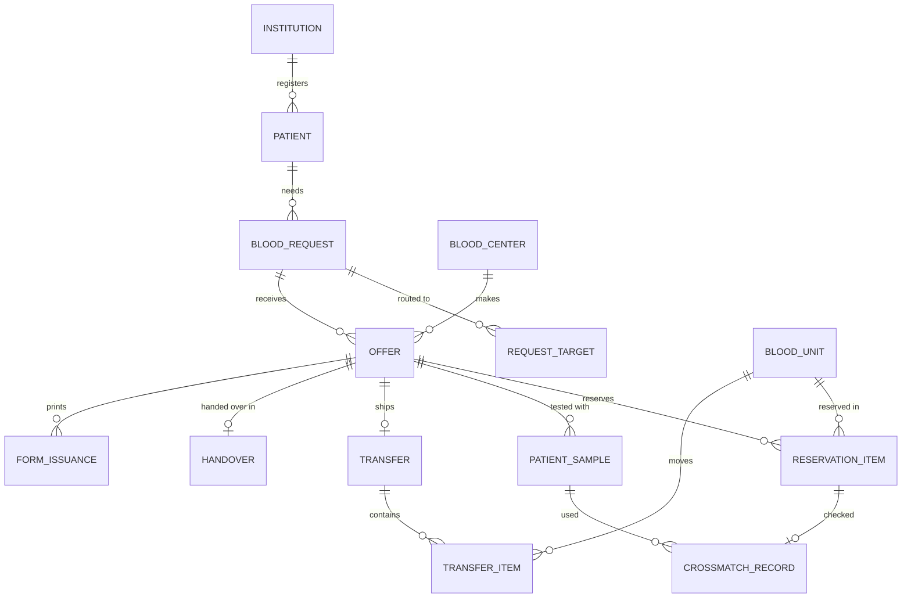

### 6.4 Table catalogue (38 tables)

Build order follows the migrations. **Bold** columns are required. `enc` means encrypted at field level. (1.1) Columns added in 1.1 are marked (1.1). No table is added.

**Migration 0001: core**

| Table | Key columns | Rules |
|---|---|---|
| `institutions` | **id, name, kind** (`hospital`/`university`/`health_body`), governorate, status | |
| `blood_centers` | **id, name, type** (`collection`/`storage`), institution_id (nullable), lat, lng, status | Donation requires `collection` |
| `center_licenses` | **center_id, activity** (`collect`/`test`/`store`/`issue`), **license_no, valid_from, valid_to**, verified_by | An active license for the activity is required for that activity |
| `users` | **id, institution_id, role**, center_id (nullable), email, password_hash, professional_license_no, status, failed_logins, locked_until | License number required for `center_physician`, `treating_doctor` |
| `sessions` | **id, user_id, expires_at**, ip, ua_hash | Revocable |
| `audit_events` | **id** (bigserial), **recorded_at, event_at**, actor_id, actor_role, institution_id, center_id, **action, entity_type, entity_id, outcome**, request_id, meta | Insert only (section 11.5) |

**Migration 0002: policy**

| Table | Key columns | Rules |
|---|---|---|
| `policy_versions` | **id, version_no, status** (`draft`/`pending`/`active`/`retired`), created_by, approved_by, clinical_signoff_name, clinical_signoff_ref, effective_from, change_reason | `approved_by ≠ created_by`. Medical parameters need clinical sign-off |
| `policy_parameters` | **policy_version_id, code, class, applies_to, value, unit**, min_hard, max_hard, tighten, source_document, source_ref, **verification_status** | Unique `(version, code, applies_to)` |

**Migration 0003: donors**

| Table | Key columns | Rules |
|---|---|---|
| `donors` | **id, center_id**, donor_card_no (null until first donation), `full_name_enc` (four-part), `national_id_enc`, `national_id_idx`, `phone_enc`, birth_date, sex, address_governorate | Unique `(center_id, national_id_idx)` |
| `donor_registry` | **registry_no, id_idx**, `full_name_enc`, fitness (`fit`/`deferred_temp`/`deferred_perm`), deferred_until, last_donation_at, last_center_id | No reasons and no results. Read only through `registry_lookup()` |
| `visits` | **id, donor_id, center_id, visit_at, status** | |
| `consents` | **id, visit_id, type** (`donation`/`testing_notification`), form_version, signed_at, recorded_by | Unique `(visit_id, type)` |
| `assessments` | **id, visit_id, questionnaire_version**, answers (jsonb), systolic, diastolic, pulse, temperature_c, weight_kg, hb_g_dl, glucose_mg_dl, glucose_context (`fasting`/`random`), rule_results (jsonb), policy_version_id, decision, decided_by, medical_reason_code, deferred_until | Measured by nurse, decided by physician |
| `donations` | **id, visit_id, collected_at, collected_by, responsible_physician_id**, bag_type, anticoagulant_solution, lot_no | `collected_by` is the performer. The physician supervises |

**Migration 0004: units**

| Table | Key columns | Rules |
|---|---|---|
| `blood_units` | **id, donation_id, unit_number** (unique), label_code, component_type, abo, rh, **status, expiry_at, center_id, version**, expiry_exception | `status` only changes through `transition_unit()` |
| `unit_events` | **id, unit_id, event_type, from_status, to_status, actor_id, event_at, recorded_at**, late_entry, reason_code, meta | Append only |
| `unit_status_transitions` | **from_status, to_status, allowed_roles** | Seed. Source of truth for allowed moves |

**Migration 0005: testing**

| Table | Key columns | Rules |
|---|---|---|
| `lab_test_orders` | **id, unit_id, test_code, status** | Created in the same transaction as the unit |
| `lab_samples` | **id, unit_id**, sample_type, collected_at, received_at, received_by | |
| `lab_results` | **id, order_id, result_status** (`negative`/`reactive`/`invalid`/`inconclusive`/`determined` (1.1)), value, performed_by, performed_at, supersedes_id, retest_round, reason | Append only. (1.1) `determined` is used only for ABO/Rh typing, with the group in `value` |
| `lab_result_reviews` | **id, result_id, reviewer_id, decision, reviewed_at**, note | Reviewer ≠ performer |
| `result_approvals` | **id, unit_id, approved_by, approved_at, results_hash** | Physician who entered no result for the unit |
| `release_decisions` | **id, unit_id, decision** (`release`/`block`/`discard`/`retest_authorized`), decided_by, reason_code, policy_version_id | |

**Migration 0006: reservations and storage**

| Table | Key columns | Rules |
|---|---|---|
| `reservation_items` | **id, offer_id, unit_id, active**, released_at, release_reason | Unique partial index `(unit_id) WHERE active` |
| `storage_temperature_logs` | **id, center_id, device_label, recorded_at, value_c, recorded_by**, deviation, action_taken | Manual entry in MVP. (1.1) `deviation` is set when `value_c` is outside `unit.storage.temp_c` (Appendix A, red cells in the MVP) |

**Migration 0007: requests**

| Table | Key columns | Rules |
|---|---|---|
| `patients` | **id, institution_id**, patient_ref, `full_name_enc`, `national_id_enc`, `national_id_idx`, `address_enc` | `patient_ref` is the only identifier shared across centers |
| `blood_requests` | **id, institution_id, requested_by, patient_id, component_type, abo, rh, qty_requested, priority, required_by, status**, qty_approved, qty_received, patient_hb_g_dl, indication, paper_authorization (`pending`/`verified`), cancelled_at, parent_request_id (1.1) | One item per request. (1.1) `parent_request_id` is nullable. It is set only when a request asks for the missing quantity of an earlier request of the same institution. It ships with that story |
| `request_targets` | **request_id, center_id, round_no, notified_at**, responded_at | Unique `(request_id, center_id)` |
| `offers` | **id, request_id, center_id, status, qty_offered**, distance_km, eta_minutes, eta_is_estimate, hold_until, fulfillment_deadline, responded_by | Hold timer applies to `offered` only |

**Migration 0008: fulfilment**

| Table | Key columns | Rules |
|---|---|---|
| `patient_samples` | **id, offer_id, tube_type, received_by, received_at, label_verified, status**, typed_abo, typed_rh, typed_by, reviewed_by | EDTA tube. Typing reviewed by a second person |
| `crossmatch_records` | **id, reservation_item_id, patient_sample_id, method, result, performed_by, performed_at**, reviewed_by, reviewed_at | Reviewer ≠ performer |
| `handovers` | **id, offer_id, handed_over_at, handed_over_by, receiver_type** (`courier`/`relative`/`hospital_staff`), receiver_name_enc, id_checked | Minimal receiver data |
| `transfers` | **id, offer_id, from_center_id, to_institution_id, status**, dispatched_at, received_at | |
| `transfer_items` | **id, transfer_id, unit_id**, dispatched_condition, received_condition, received_at, discrepancy_reason | One row per unit |
| `form_issuances` | **id, form_type, form_no, entity_type, entity_id, generated_by, generated_at**, content_hash | Registry of printed forms |

**Migration 0009: content and notifications**

| Table | Key columns | Rules |
|---|---|---|
| `kb_articles` | **id, question, answer, status**, keywords, author_id, reviewer_id, source_ref, version, published_at | Reviewer ≠ author |
| `notifications` | **id, user_id, kind, entity_type, entity_id, created_at**, read_at | No health data, no identifiers |
| `idempotency_keys` | **key, user_id, endpoint, request_hash**, response, created_at | |

> Do not build all tables at once. Each migration ships with the story that needs it. Optional tables (`storage_temperature_logs`, `form_issuances`, `idempotency_keys`) arrive only when their story starts.

### 6.5 Data classification and protection

| Class | Examples | Protection |
|---|---|---|
| **Direct identifiers** | national ID, full name, address, phone | AES-256-GCM per field, search via HMAC index, never in logs, URLs, notifications, errors |
| **Health data** | measurements, answers, results, deferrals, patient Hb | Role-limited reads, audit on identity views, no export |
| **Operational** | unit status, stock counts, offers | Scoped by center or institution |
| **Policy and content** | parameters, articles | Versioned, reviewed |

- Two keys, both outside the database and its backups: `DATA_ENC_KEY` and `ID_INDEX_KEY`. A `key_ver` column supports rotation.
- National ID and name together are low entropy. Keeping the HMAC key separate and out of backups is the main control, not the HMAC itself.
- Phone numbers are validated as Egyptian mobile numbers (`^01[0125][0-9]{8}$`) and stored encrypted.

### 6.6 Synthetic data rules
- Synthetic national IDs use an **invalid governorate code** (`00`). They cannot belong to a real person.
- The validator accepts code `00` **only when `USAGE_MODE=demo`**. In any other mode it rejects them.
- Names are generated, never copied. Phone numbers use a documented reserved test pattern.
- Every seed record carries `synthetic = true` or a recognizable prefix. CI checks that no seed file contains real-looking data.

### 6.7 Migration policy
- One concern per migration. Applies cleanly to an empty database.
- Number reflects **merge order**. Parallel branches rebase and renumber before merge.
- One person owns final review of `db/` changes (Appendix C).
- Forward-only. Rollback is by a new migration or a restore.
- Functions (`transition_unit`, `unit_release_ready`) live in `db/functions/` and are re-applied by a migration when changed.

---

## 7. Lifecycles and invariants

### 7.1 Unit

`Collected` is an **event**, not a stored state. A unit is created directly as `Quarantined` in the collection transaction.

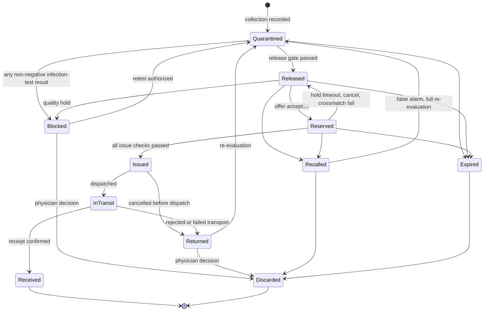

| # | From | To | Actor | Guard (all must hold) |
|---|---|---|---|---|
| 1 | (new) | Quarantined | RN, CP | Visit accepted by physician. Center has `collect` license and type `collection`. Registry re-check passed under row lock. Test orders created in the same transaction |
| 2 | Quarantined | Released | CP | **Release gate** G1 to G9 (below) |
| 3 | Quarantined | Blocked | system | A result entered with status other than `negative` or `determined` (1.1) |
| 4 | Blocked | Quarantined | CP | `retest_authorized` decision with reason. New results are marked as a retest round |
| 5 | Blocked | Discarded | CP | Reason code |
| 6 | Released | Reserved | system (via bank answer) | Not expired plus safety margin. No hold, recall, or quality exception. Active reservation unique |
| 7 | Released | Blocked | BM, CP | Quality hold with reason |
| 8 | Released, Reserved, Quarantined | Expired | system | `expiry_at` passed and the unit is in the center's custody |
| 9 | Released, Reserved | Recalled | BM, CP | Reason code |
| 10 | Reserved | Released | system, BM | Offer in `offered` state timed out, or cancel, or crossmatch failed. Unit still valid and not held or recalled |
| 11 | Reserved | Issued | BM | Offer approved. Paper request verified. Patient sample accepted. Crossmatch compatible and reviewed. Not expired |
| 12 | Issued | InTransit | BM | Dispatch recorded with transfer item |
| 13 | Issued | Returned | BM | Cancelled before dispatch |
| 14 | InTransit | Received | receiving staff | Condition `ok` confirmed at the requesting institution |
| 15 | InTransit | Returned | receiving staff, BM | Deviation, rejection, or failed transport |
| 16 | Returned | Quarantined | BM, CP | Evaluation recorded with outcome `pass` (1.1) |
| 17 | Returned | Discarded | CP | Reason code |
| 18 | Expired, Recalled | Discarded | BM, CP | Reason code |
| 19 | Recalled | Quarantined | CP | False alarm, full re-evaluation |

**Expiry outside custody.** The expiry job changes status only for units in the center's custody (rows 8). If `expiry_at` passes while a unit is `Issued` or `InTransit`:
- Status does **not** change to `Expired`.
- `expiry_exception = true` is set, an audit event is written, and both centers get a notification.
- The unit cannot be reported `Received` as valid. Receipt must go through the rejection path (row 15), and the exception is resolved by a physician decision.
- After `Received`, expiry is out of scope.

**Terminal states:** `Received`, `Discarded`.

### 7.2 Release gate (`unit_release_ready`)
A database function returns `ok` plus a list of failures. `transition_unit(..., 'Released')` calls it.

| # | Condition |
|---|---|
| G1 | The unit is linked to a donation made at a center that holds an active `collect` license |
| G2 | Every required infection test has a **current** result (not superseded by a later unreviewed result) (1.1) |
| G3 | Every current infection-test result is `negative` (1.1) |
| G4 | Every current infection-test result has a confirmed technical review by a user different from the performer (1.1) |
| G5 | A physician approval exists for the exact result set (`results_hash`). The physician entered no result for this unit |
| G6 | ABO and Rh are determined and reviewed. The blood group is covered here, not by G2 to G4 (1.1) |
| G7 | The unit is not expired, and expiry was computed under the active policy |
| G8 | No open hold, recall, or quality exception |
| G9 | The policy version used is recorded |

(1.1) **Scope of G2 to G4.** They apply to the infection tests of `lab.required_tests` (Appendix A). ABO and Rh are typing results, not `negative` or `reactive`, so G3 cannot apply to them. G6 covers them.

One physician action writes `result_approvals` and `release_decisions` in a single transaction. A new negative result **never** clears a reactive one by itself. Only `retest_authorized` re-opens testing.

### 7.3 How transitions are enforced
`transition_unit(unit_id, to_status, actor_id, reason_code, expected_version)`:

1. Looks up the **actor's role and scope from `users`**, not from caller input.
2. Locks the unit row `FOR UPDATE` and checks `expected_version`.
3. Checks `(from_status, to_status)` and the actor role against `unit_status_transitions`.
4. Checks the guard conditions for that transition.
5. Updates the unit and inserts a `unit_events` row in the same transaction.

Hardening:
- `SECURITY DEFINER` with `SET search_path = pg_catalog, public`.
- `REVOKE EXECUTE ... FROM PUBLIC`. Granted only to the application role.
- A trigger on `blood_units` rejects any change of `status` not made inside `transition_unit` (transaction-local flag).
- The application role has no `UPDATE` privilege on `blood_units.status`.
- The same table exists in TypeScript (`TRANSITIONS`) for clear error messages. A test fails if the two disagree.

### 7.4 Request, offer, and fulfilment
Requests are **aggregates**. **Offers carry the fulfilment steps.** Unit status and request status are different things.

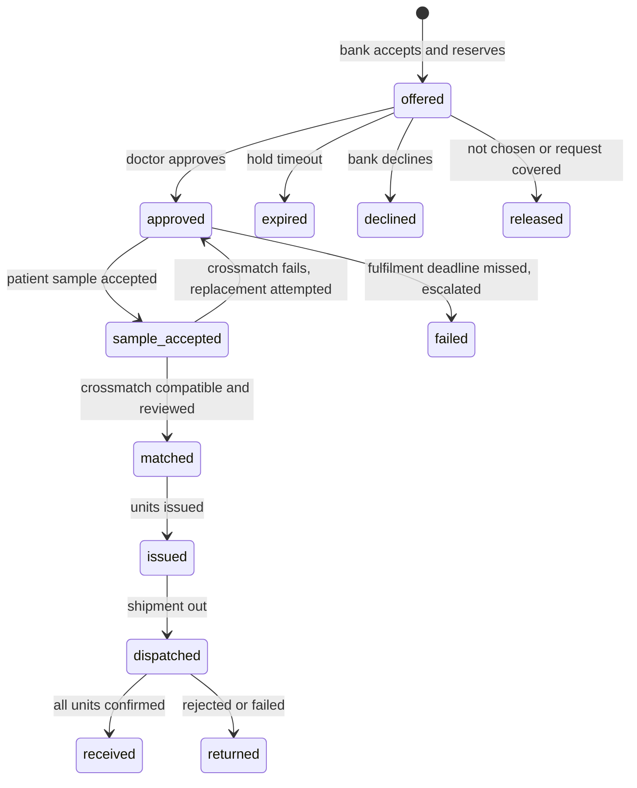

Request status is derived from its offers:

| Status | Meaning |
|---|---|
| `Open` | Routing or waiting for offers. `qty_approved < qty_requested` |
| `Covered` | `qty_approved = qty_requested`, fulfilment not finished |
| `InFulfilment` | At least one approved offer is past sample acceptance |
| `Completed` | `qty_received = qty_requested` |
| `PartiallyCompleted` | Closed with `qty_received < qty_requested` by physician decision |
| `Unfulfilled` | Routing exhausted with nothing approved |
| `CancelRequested` | Cancel asked after something was dispatched. Closed only when every unit is settled |
| `Cancelled` | Cancelled with nothing dispatched, or all dispatched units settled |

**Rules**
1. One item per request. Several approved offers may cover it. The MVP UI approves one offer at a time. The backend supports more.
2. Approving an offer that covers less than `qty_requested` records `qty_approved` and **keeps routing the remainder**. Other `offered` offers stay held until the remainder is covered, their timer ends, or the request is closed.
3. The **hold timer** (`hold_until`) applies to offers in `offered` only. An `approved` offer is never released by it. It has a `fulfillment_deadline`. Near the deadline the system **escalates** (notifications). After it passes, the offer enters `failed`, the units are checked individually before release, and the remainder goes back to routing.
4. (1.1) **Cancel before issue:** reserved units return to `Released` (row 10). **Cancel after issue and before dispatch:** the issued units go to `Returned` (row 13) and are evaluated. **Cancel after dispatch:** request becomes `CancelRequested`. Each dispatched unit is settled as `Received` or `Returned`. A unit that was issued never returns to available stock automatically. A returned unit goes to evaluation (rows 16 and 17).
5. Crossmatch failure: the unit returns to `Released`, the system tries another unit from the same offer, and the missing quantity goes back to routing.

### 7.5 Donor visit
`registered → consented → screening → (deferred | accepted) → collected → closed` plus `abandoned`.

`collected` requires:
- both consents signed for this visit,
- an `accepted` decision by a physician,
- no active deferral and a passed registry check,
- a collection center with a valid `collect` license,
- **a repeat registry check inside the saving transaction under `FOR UPDATE`** (section 8.1).

Two centers may open visits for the same donor. They cannot both complete a donation: the second to reach the lock sees the updated registry row and is refused.

### 7.6 Invariants

| # | Invariant | Enforced by |
|---|---|---|
| I1 | No release unless G1 to G9 | `unit_release_ready` in `transition_unit` |
| I2 | A unit has at most one active reservation | Partial unique index plus `FOR UPDATE SKIP LOCKED` plus status check |
| I3 | Status changes only through `transition_unit` | Trigger plus privileges |
| I4 | History tables are append-only | Trigger plus `REVOKE` |
| I5 | No donation at a `storage` center or without a valid license | Constraint plus service guard |
| I6 | No reservation or issue of an expired, blocked, or recalled unit | Guard in `transition_unit` |
| I7 | A non-negative infection-test result blocks the unit (1.1) | Result entry service plus test |
| I8 | Reviewer is not the performer. Approver entered no result | `CHECK` constraints and service checks |
| I9 | Every assessment and release stores its policy version | Column plus test |
| I10 | A patient's name and national ID are visible only to the issuing bank after approval | Dedicated endpoint plus audit |
| I11 | Issue requires verified paper request, accepted sample, reviewed crossmatch | Guard on transition 11 |
| I12 (1.1) | The chatbot cannot change data or read identity | API channel guard (`X-Channel: chatbot`, GET allow-list), no service credentials, UI card allow-list |

---

## 8. Key workflows

### 8.1 Donation to unit

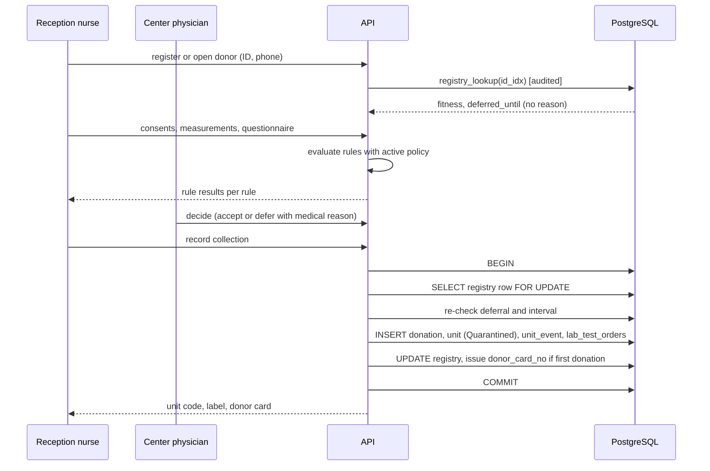

### 8.2 Testing and release

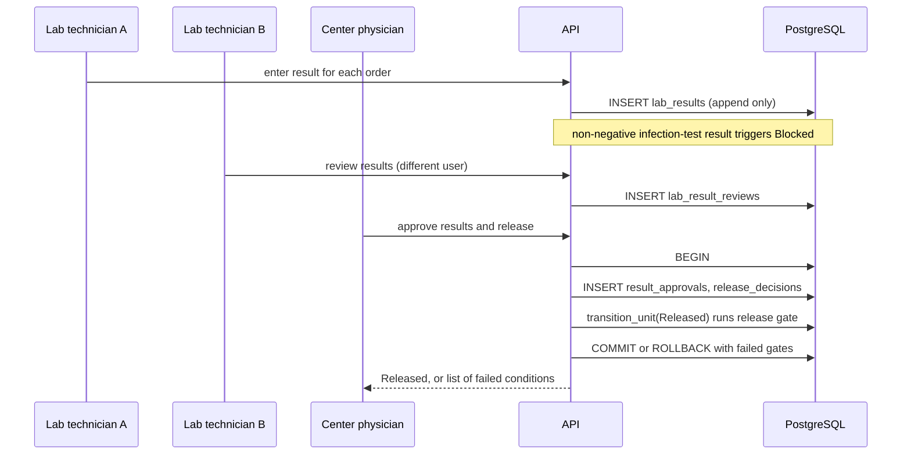

### 8.3 Request, offer, approval

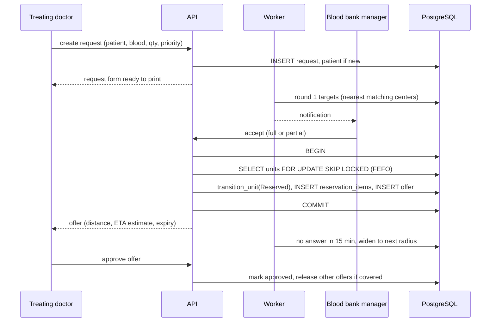

### 8.4 Fulfilment with paper forms

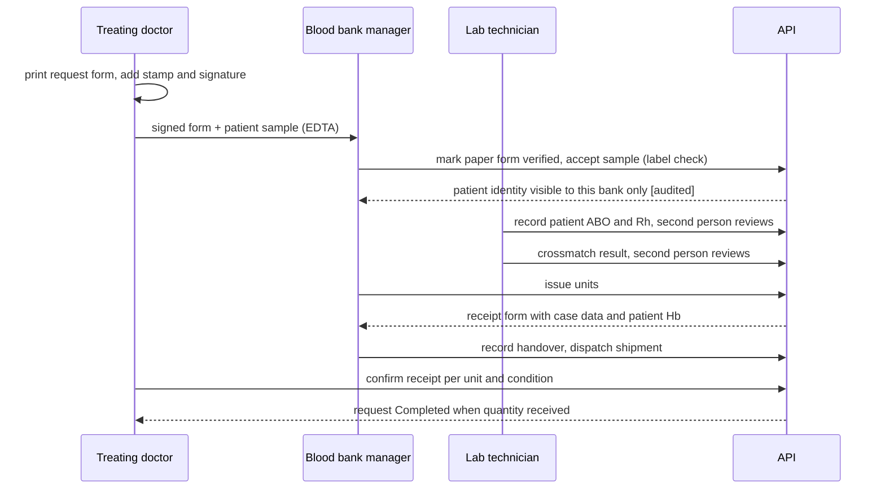

### 8.5 Cancel after dispatch
`CancelRequested` is set. Each unit is confirmed `Received` or `Returned` at the requesting side. The request closes as `Cancelled` or `Completed` when every unit is settled. A returned unit goes to evaluation, never straight to stock.

### 8.6 Concurrency design
- The index `one_active_reservation` is the last safety net.
- The reservation transaction selects with `FOR UPDATE SKIP LOCKED`, calls `transition_unit`, and inserts the reservation. Any failure rolls back everything.
- Worker jobs claim work with `FOR UPDATE SKIP LOCKED` and hold an advisory lock per job type. Running a job twice is safe.
- Idempotency keys protect sensitive POSTs against retries.

### 8.7 Assistant prepares a request form (1.1)
The chatbot has no write path. It reads, and it prepares a card. The browser submits the form under the user's own session, as in 8.3.

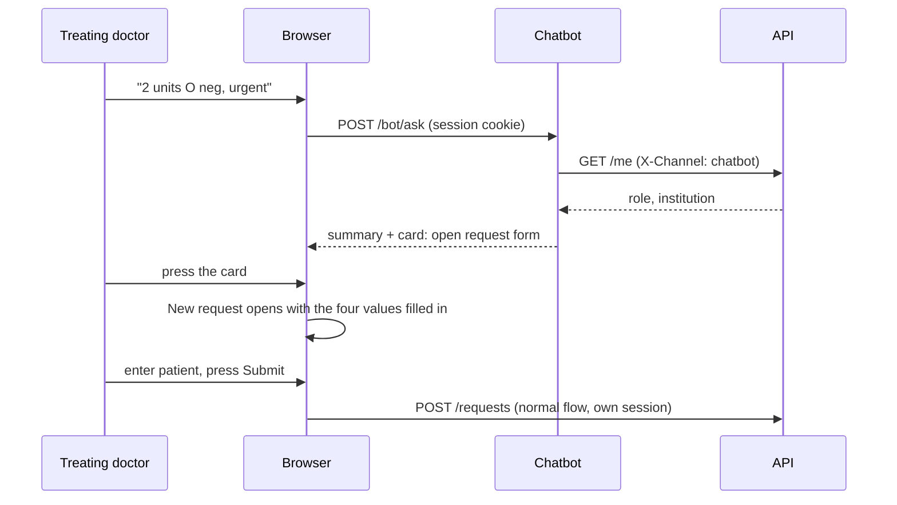

---

## 9. Documents and printing

Paper is part of the real workflow, so printed documents are first-class.

| Form | When | Content | Notes |
|---|---|---|---|
| **Request form** | Doctor submits a request | Hospital name, patient name, national ID, address, doctor name and license no., requested component, group and quantity, priority, patient Hb, indication, date and time, request number, blanks for administration **stamp and signature** | Pre-filled. The doctor prints, stamps, signs |
| **Receipt form** | Units issued | Blood center, request number, unit numbers, groups, expiry, crossmatch result, **case data and patient hemoglobin**, receiver details, date and time, signature blanks | Printed at issue |
| **Donor card** | After first completed donation | Card number, name, birth date, nationality, donation type, date and place | Issued after the donation, not at reception |
| **Unit label** | Unit created | Unit number, label code, component, expiry (if known), barcode | **No personal data.** Label code is generated when the unit is `Released` |

**Design**
- Server-rendered HTML with a print stylesheet. Browser print to paper or PDF. No PDF server in the MVP.
- Each print is recorded in `form_issuances` (type, number, who, when, content hash) so duplicates and reprints are traceable.
- The blood bank records `paper_authorization = verified` after checking the signed and stamped form. **Issue is blocked until then** (invariant I11).
- Form numbers are sequential per institution or center and unique.

---

## 10. API architecture

### 10.1 Conventions
- REST over HTTPS. JSON. Base path `/api/v1`.
- Resource names are plural nouns. State changes use action sub-resources (`/offers/:id/approve`).
- Dates are ISO 8601 UTC.
- Pagination: `?limit=&cursor=`. Max limit 100.
- Every request has an `X-Request-Id` (generated if missing), echoed in logs and errors.
- Mutations that matter require `Idempotency-Key`.
- (1.1) A lookup by identifier is a read, but it uses `POST` with the identifier in the body, because identifiers never go in a URL (section 11.4). It needs no `Idempotency-Key` and is audited.
- CSRF: cookie auth plus a custom header (`X-CSRF-Token`) on non-GET.
- OpenAPI generated from Zod schemas. The web client uses the generated types.

> **Channel rule (1.1).** A request with `X-Channel: chatbot` is accepted only for these endpoints, all GET: `/me`, `/requests`, `/requests/:id`, `/inbox/requests`, `/inventory` (with its query parameters), `/inventory/expired`, `/public/centers`. Anything else gets `403 CHANNEL_NOT_ALLOWED` before any role check, including every non-GET call and the identity views (`/donors/lookup`, `/patients/lookup`, `/offers/:id/patient-identity`). The chatbot forwards the user's cookie and can read only what that user can read. If the offers list gets its own GET endpoint, add it to the list.
>
> **What this guard does not claim.** The header is set by the chatbot code itself. The guard stops a chatbot bug, or any message text, from leading to a write or an identity read. It is not protection against someone who controls the chatbot container.

### 10.2 Error model

```json
{
  "error": {
    "code": "RELEASE_GATE_FAILED",
    "message": "Results are not fully reviewed",
    "details": [{ "gate": "G4", "reason": "HBV result has no review" }],
    "request_id": "..."
  }
}
```

| HTTP | Used for |
|---|---|
| 400 | Malformed input |
| 401 | Not authenticated |
| 403 | Role or scope not allowed. Audited as `denied`. (1.1) Also any call from the chatbot channel outside the allow-list |
| 404 | Not found *or not visible to this scope* |
| 409 | State conflict (unit already reserved, transition not allowed, version mismatch) |
| 422 | Business rule failed (rule below limit, gate failed) |
| 429 | Rate limited |

### 10.3 Endpoint catalogue

| Module | Endpoint | Roles | Notes |
|---|---|---|---|
| identity | `POST /auth/login`, `/auth/logout`, `GET /me` | all | Lockout, rate limit |
| identity | `POST /institutions`, `/centers`, `/centers/:id/licenses` | system_admin | |
| identity | `POST /users`, `PATCH /users/:id/status` | facility_admin, system_admin | Own institution only for facility_admin |
| policy | `GET /policy/active` | staff | |
| policy | `POST /policy/drafts`, `/policy/drafts/:id/approve`, `/signoff` | system_admin | Approver ≠ creator. Clinical sign-off for medical parameters |
| audit | `GET /audit` | system_admin | Filters by entity, actor, date |
| donors | `POST /donors/lookup` | reception_nurse, center_physician | (1.1) Body: national ID. The server computes the index, because the client never holds the index key. Read only. Audited |
| donors | `POST /donors`, `PATCH /donors/:id` | reception_nurse | |
| donors | `POST /visits`, `/visits/:id/consents`, `/visits/:id/assessment` | reception_nurse | |
| donors | `POST /visits/:id/decision` | center_physician | |
| donors | `POST /donations` | reception_nurse | The collection transaction |
| testing | `GET /units/:code` | BM, CP, LT | Identity hidden unless permitted. (1.1) The response includes the donation id |
| testing | `POST /units/:id/results` | lab_tech | Append only |
| testing | `POST /results/:id/review` | lab_tech | Reviewer ≠ performer |
| testing | `POST /units/:id/approve-and-release` | center_physician | Release gate |
| testing | `POST /units/:id/decisions` | center_physician | `block`, `discard`, `retest_authorized` |
| inventory | `GET /inventory` | BM, CP | By group, component, status. (1.1) optional `?expiring_within_days=` (the same data as the expiry warning on the blood bank home screen) |
| inventory | `GET /inventory/expired`, `POST /units/:id/removal` | BM | Confirm removal from storage |
| inventory | `POST /units/:id/evaluation` (1.1) | BM, CP | Evaluation of a `Returned` or `Recalled` unit. Outcome `pass`: back to `Quarantined` (rows 16, 19). Outcome `fail` (`Returned` only): recorded in `unit_events`, and the unit stays `Returned` for a physician decision. Outcome `discard`: `Discarded` (rows 17, 18). Reason required. The role is checked per row (section 7.3) |
| inventory | `GET /donations/:id/units` (1.1) | BM, CP | Units of one donation with their status. Own center only. The donation id comes from `GET /units/:code` |
| inventory | `POST /temperature-logs` | BM | Manual log |
| requests | `POST /requests`, `GET /requests`, `GET /requests/:id` | treating_doctor | Own institution. (1.1) `GET /requests/:id` includes the offers with distance, ETA estimate and expiry. Used by the assistant and the offers screen |
| requests | `POST /patients/lookup` (1.1) | treating_doctor | Body: national ID. Own institution only. Read only. Audited. Fills the request form (section 12.3) |
| requests | `GET /requests/:id/form` | treating_doctor | Print view |
| requests | `POST /requests/:id/cancel` | treating_doctor | |
| requests | `GET /inbox/requests` | BM | Requests routed to this center |
| requests | `POST /requests/:id/offers` | BM | Accept, partial, decline |
| requests | `POST /offers/:id/approve` | treating_doctor | |
| requests | `POST /offers/:id/paper-verification` | BM | Signed and stamped form received |
| requests | `POST /offers/:id/patient-sample` | BM | EDTA, label verification |
| requests | `GET /offers/:id/patient-identity` | BM, LT | Audited. Only after approval |
| requests | `POST /samples/:id/typing`, `/typing/:id/review` | lab_tech | |
| requests | `POST /reservations/:id/crossmatch`, `/crossmatch/:id/review` | lab_tech | Reviewer ≠ performer |
| transfers | `POST /offers/:id/issue` | BM | Checks I11. Generates receipt form |
| transfers | `POST /offers/:id/dispatch`, `/handover` | BM | |
| transfers | `POST /transfer-items/:id/receive` | treating_doctor | Condition per unit |
| transfers | `POST /transfer-items/:id/return` | treating_doctor, BM | |
| transfers | `POST /donations/:id/recall` (1.1) | BM, CP | Row 9 for every `Released` or `Reserved` unit of the donation, with a reason. A reserved unit cancels its offer. Institutions that already received a unit get a notification. `Issued` and `InTransit` units are not covered (Appendix B, item 10). Needs `Idempotency-Key` |
| documents | `GET /documents/:type/:id` | by form type | Print views |
| content | `GET /kb/published` (public), `POST /kb`, `/kb/:id/submit`, `/kb/:id/review` | system_admin | Reviewer ≠ author |
| public | `GET /public/centers` | none | Only centers with an active collect license |
| chatbot | `POST /bot/ask` | none (1.1: any role, with or without a session) | Rate limited. Behind nginx at `/bot/ask`. The chatbot reads the caller's session itself |

---

## 11. Security architecture

### 11.1 Authentication
- Passwords: argon2id. Minimum length and a deny-list of common passwords.
- Sessions: server-side, revocable, idle and absolute timeouts, rotated on login.
- Lockout after 5 failed attempts for 15 minutes. All attempts audited.
- MFA (TOTP) is **a separate feature with its own acceptance criteria**, planned for week 11 if time allows. Until then admin accounts must not be used on real data. Do not ship a half-implemented MFA.

### 11.2 Authorization
- Permission checks run in the **service layer** with `(role, scope, resource, action)`. Routes only authenticate and validate.
- Roles are fixed in code. A role maps to permissions in one table.
- Separation of duties is encoded as constraints, not as policy text:

| Rule | Where |
|---|---|
| Reviewer ≠ performer (results, typing, crossmatch) | `CHECK` and service |
| Approver of results entered none of them | Service and release gate G5 |
| Policy approver ≠ author | `CHECK` |
| Content reviewer ≠ author | `CHECK` |
| The assistant channel cannot write or read identity (1.1) | Channel guard in the API, tested for every endpoint and role (T-23) |

### 11.3 Tenant isolation (honest version)
**MVP:** tenant scope is enforced **in the API**. Every repo function requires a `Scope` and filters by it. A lint rule forbids repo functions without a `Scope` parameter. The application database role has limited privileges and no ownership of tables. Every endpoint and every table is covered by an **API tenant-isolation test** (T-14): a user of center A cannot read, change, or join data of center B.

**Not claimed:** database-level isolation. RLS is deferred. If implemented later it needs its own policies for read, insert, update, and delete, `FORCE ROW LEVEL SECURITY`, and its own test suite (T-14b). The app role must not be a table owner or a role with `BYPASSRLS`.

**Intended cross-scope reads (all minimal):**
- Offers: visible to the requesting institution and the offering center.
- Network stock view: counts per center, group, component. No unit IDs.
- Donor registry: via `registry_lookup()`, audited.
- Patient identity: to the issuing bank after approval, audited.

### 11.4 Data protection
See section 6.5. Additional controls:
- Identifiers never appear in URLs, logs, error messages, notifications, or chatbot input. (1.1) The chatbot discards digit runs that look like a national ID or a phone number before it processes a message, and tells the user to enter the patient on the request form.
- No bulk export of identifying data.
- Backups are encrypted. Encryption keys are stored separately from backups.
- Demo mode rejects real-looking identifiers (section 6.6).

### 11.5 Audit and history
- `audit_events` records security-relevant events: logins, denied actions, identity views, policy and content changes, approvals, exports. `unit_events` records unit lifecycle. A status change is logged once, in `unit_events`.
- The application role has `INSERT` only on both. Triggers block `UPDATE` and `DELETE`. Owner and admin access is limited and logged operationally. Backups are the second line.
- `before/after` values are stored only for editable entities (users, institutions, policy drafts, content), with an allow-list of fields. Never passwords, identifiers, or full results.
- Retention is decided with legal advice. The schema is ready for monthly partitioning. Partitioning itself is deferred.
- Hash chaining and external anchoring are Phase 2.

### 11.6 Threat model (summary)

| Threat | Mitigation |
|---|---|
| SQL injection | Parameterized queries only. No string-built SQL. Query layer lint |
| Broken access control (IDOR) | Scope required in every repo. API isolation tests per endpoint |
| Session theft, CSRF | HttpOnly cookie, SameSite, CSRF header, short idle timeout |
| Privilege escalation through `transition_unit` | Actor role read from `users`. `SECURITY DEFINER` with fixed `search_path`. `EXECUTE` revoked from `PUBLIC` |
| Duplicate submissions | `Idempotency-Key`, unique constraints |
| Insider snooping | Identity-view audit, minimal visibility, role limits |
| Admin abuse of policy | Two-person approval, clinical sign-off, hard limits in the seed |
| Tampering with history | Append-only triggers, no `UPDATE`/`DELETE` privilege, encrypted backups |
| Secret leakage | Secret scanning, `.env.example` only, no secrets in images |
| Chatbot misuse | Published content only, medical referral, rate limit |
| Prompt injection or "approve it" attempts (1.1) | The chatbot holds no credentials and has no write path. The API accepts only an allow-list of GETs from its channel. It forwards the caller's own session, so it cannot exceed the caller's role. Approval attempts are refused by a guard |
| Forged Action Card (1.1) | The UI runs only `open_screen` and `open_request_form`. Both only navigate. A forged card can at most open a screen of the user's own role or fill form defaults. No API call is made by a card |
| Wrong values in the prefilled form (1.1) | A summary comes before the card. The values are defaults only. The doctor reviews the form and submits it. The API validates everything again |
| Real data in demo | Synthetic ID rule, CI check on seed files |

---

## 12. UX architecture

### 12.1 Principles
Clinicians are short on time. The system must be faster than paper.

1. **One screen, one job.** Each task fits one screen with no wizard unless unavoidable.
2. **Inbox first.** Every role lands on the next things it must do.
3. **Fewest fields.** Everything derivable is pre-filled. Required fields are only what the paper form requires.
4. **Reuse.** Known patients and donors autofill from a national ID.
5. **Keyboard and scanner friendly.** Autofocus, Enter to advance, scanner input in the unit field.
6. **Prevent errors.** Inline validation, clear rule results, disabled actions with a reason.
7. **Confirm only irreversible actions.**
8. **Paper-compatible.** Print buttons where paper is part of the process.
9. **Chat helps, screens decide.** (1.1) The assistant answers and prepares. Every effect happens on a screen the user sees and confirms.

### 12.2 Role home screens

| Role | Home shows |
|---|---|
| Treating doctor | **New request** (large), my open requests with progress, offers waiting for approval |
| Blood bank manager | Incoming requests, approved offers to fulfil, units to remove, expiry warnings |
| Lab technician | Units awaiting results, results awaiting review, crossmatches waiting |
| Center physician | Donors awaiting decision, units awaiting approval, blocked units |
| Reception nurse | Today's visits, **New donor visit** (large) |
| Admins | Pending policy approvals, content to review |

### 12.3 Request form (the doctor's main task)

| Field | Rule | Default or autofill |
|---|---|---|
| Hospital, doctor, department, date and time | Not editable | From the user profile |
| Patient national ID | Required | Lookup in institution's patients |
| Patient full name (four parts) | Required for new patient | Autofilled if known |
| Patient address | Required for new patient | Autofilled if known |
| Component | Required | Red cells |
| Blood group and Rh | Required | None |
| Quantity | Required | 1 |
| Priority | Required | Urgent |
| Patient hemoglobin | Optional | Appears on the receipt form |
| Indication | Optional | Short list plus free text |

Buttons: **Submit** and **Submit and print form**. Time target: a repeat patient in under 60 seconds, a new patient in under 2 minutes, measured in week 9 (NFR-11).

### 12.4 Other fast paths
- **Reception:** national ID → file opens (or is created) → consents → measurements → rule chips (green or red with reason) → send to physician.
- **Physician queue:** one row per donor, rule chips visible, Accept or Defer with a reason dropdown.
- **Lab entry:** one grid per unit with all required tests, keyboard entry, scan or paste the unit code.
- **Unit lookup:** a single scanner-ready field on every bank screen.
- **Offer comparison:** best offer preselected, one click to approve, far offers visibly marked "estimate" and "too far".
- (1.1) **Assistant panel:** a floating button on every screen. Suggested questions per role. A card says in plain words what it will do ("Open the request form with these values") and has one button.

### 12.5 Donor questionnaire
Structured items with a code, a type (yes or no, date, text), and a version. Includes at least: current health, medication, chronic conditions, **surgeries with date**, dental work, transfusion history, vaccinations, infection risk, travel, and questions for women. Blood pressure, pulse, temperature, weight, hemoglobin, and **blood glucose with context** are measured values. Rules apply only where the policy defines a verified rule. Other answers are recorded for the physician.

### 12.6 Workspaces (screen groups)

| Workspace | Screens inside (tabs) |
|---|---|
| Administration | Institutions, centers, licenses, users, policy, content review |
| Donor intake | Search and register, consents, measurements, collection, label, donor card |
| Physician | Eligibility decisions, result approval and release, blocked units |
| Lab | Result entry, review, typing, crossmatch |
| Stock | Stock, expiry and removal, temperature log, unit lookup |
| Requests (doctor) | New request, my requests, offers, receipt |
| Bank operations | Inbox, offers, paper verification, sample, issue, dispatch |
| Audit | Audit log, unit history |
| Public | Information, centers, chatbot |

(1.1) The assistant panel is part of every workspace and is not a tenth workspace.

### 12.7 Quality bars
- Arabic, right to left, laptop for staff and 360 px phones for the public portal.
- p95 page load under 2 seconds at demo scale.
- Contrast and focus states meet basic accessibility checks. Targets are large enough for touch.
- Every list has loading, empty, and error states.

---

## 13. Quality architecture

### 13.1 Test strategy

| Level | Covers | Tools |
|---|---|---|
| Unit | Rule evaluator, validators, transition table equality, form rendering | Vitest |
| Integration (real PostgreSQL) | `transition_unit`, release gate, reservation concurrency, append-only, jobs, idempotency | Vitest, Testcontainers or Actions service |
| API | Role and scope for every endpoint, error codes | Supertest |
| End to end (few) | The main path of section 1.3 | Playwright (optional) |
| Performance | NFR-03, NFR-04 | Locust |
| Security | Dependency scan, secrets scan, basic OWASP checks | `npm audit`, `pip-audit`, gitleaks |
| Assistant evaluation (1.1) | Fixed question, slot, guard and role sets (section 5.7) | pytest in CI |

Rule: **each story ships with its tests.** Week 9 is for integration, hardening, and fixes, not for writing the first tests.

### 13.2 Mandatory tests

| ID | Test |
|---|---|
| T-01 | Every allowed and forbidden transition. SQL table equals TypeScript table |
| T-02 | Direct `UPDATE` of unit status by the app role is rejected |
| T-03 | Release rejected for each failed gate G1 to G9 |
| T-04 | A non-negative infection-test result blocks. A later negative does not unblock without `retest_authorized`. A `determined` ABO/Rh result does not block (1.1) |
| T-05 | `UPDATE` and `DELETE` rejected on audit, unit events, results |
| T-06 | 20 concurrent reservations of one unit: exactly one succeeds (100 runs) |
| T-07 | 20 concurrent reservations over 5 units: exactly 5 succeed |
| T-08 | Exception mid-reservation rolls back everything |
| T-09 | Hold-timeout job run twice gives the same result |
| T-10 | Hold timer does **not** release an `approved` offer. Deadline escalates |
| T-11 | Same donor completing in two centers at once: only one completes |
| T-12 | Routing rounds are idempotent |
| T-13 | Cancel after dispatch gives `CancelRequested`, units not returned to stock |
| T-14 | **API tenant isolation** for every endpoint and table |
| T-15 | Role matrix: every endpoint for every role |
| T-16 | Donation at a `storage` center or with an expired license is rejected |
| T-17 | Policy: tighten-only, hard limits, second approver, clinical sign-off |
| T-18 | Chatbot: medical referral 100%, drafts never shown |
| T-19 | No identifiers in logs, errors, notifications |
| T-20 | Unit expires while `InTransit`: flagged as exception, not marked valid on receipt |
| T-21 | Issue refused without verified paper form, accepted sample, reviewed crossmatch |
| T-22 | Synthetic ID accepted in demo mode and rejected otherwise |
| T-23 (1.1) | Every call with `X-Channel: chatbot` outside the GET allow-list gets 403, for every endpoint and every role. This includes the identity views |
| T-24 (1.1) | The chatbot discards ID and phone digits. No identifier reaches its replies, its logs or a card |
| T-25 (1.1) | A chatbot tool returns only what the caller's role and scope allow. A doctor of institution A asking about a request of institution B gets "not found". A role without a tool gets no data and no card |

### 13.3 CI pipeline
`lint` → `typecheck` → unit → integration (PostgreSQL) → API → (1.1) assistant evaluation → build images → (on `main`) deploy to staging → smoke tests. Boundary lint and the seed-data check are part of `lint`.

### 13.4 Non-functional targets

| ID | Target | Priority |
|---|---|---|
| NFR-01 | argon2id passwords. Identifiers encrypted. Keys outside the database and backups | Must |
| NFR-02 | 100% of sensitive events audited. No `UPDATE` or `DELETE` on history by the app | Must |
| NFR-03 | New request reaches first-round centers in under 10 s (95%), 50 concurrent users | Must |
| NFR-04 | Stock page and unit lookup under 2 s (95%), 10,000 units, 50 concurrent users | Should |
| NFR-05 | 20 simultaneous reservations: exactly one wins, 100 runs | Must |
| NFR-06 | No patient data, identifiers, or results in public pages, notifications, logs, errors | Must |
| NFR-07 | Daily encrypted backup. Restore tested and under 60 minutes | Should |
| NFR-08 | New nurse completes registration plus check in under 5 minutes after 15 minutes of training | Should |
| NFR-09 | Arabic RTL. Staff on laptop. Public page on 360 px | Should |
| NFR-10 | API tenant isolation proven by tests | Must |
| NFR-11 | Doctor submits a repeat-patient request in under 60 s (median) and a new patient in under 2 min | Should |

---

## 14. Operations

| Area | Design |
|---|---|
| Release | Merge to `main` deploys staging. A version tag deploys the demo host after approval |
| Rollback | Redeploy the previous image tag. Documented in `runbook.md`. Database changes are forward-only, so rollback of data uses restore |
| Backups | Daily `pg_dump`, encrypted, copied off the host. Restore drill before the demo, time recorded. Targets: RPO 24 hours, RTO 4 hours for the demo |
| Monitoring | `/health` and `/ready`, container health, job lag (oldest unprocessed job), disk space. Alert by email |
| Logs | JSON, rotated, no identifiers. Searchable by `request_id` |
| Config | Typed, validated at startup. Different secrets per environment |
| Chatbot restart (1.1) | Session state is in memory. A restart loses open conversations only. Nothing is lost in the database |
| Downtime procedure | Paper forms are the fallback. After recovery, entries are made with `event_at` (real time) and `recorded_at`, marked `late_entry`, reviewed by a second person. Late entries cannot break the state machine. Out-of-order entries go to manual review |
| Runbook | Deploy, rollback, backup, restore, rotate keys, add a center, reset a lockout, handle a failed job |

---

## 15. Architecture decisions

| ADR | Decision | Status | Rationale |
|---|---|---|---|
| 001 | Modular monolith | Accepted | Team size and timeline. Clear module boundaries instead of services |
| 002 | TypeScript, Node.js, Express 5 | Accepted | Team stack. Structure enforced by layout and lint |
| 003 | PostgreSQL enforces critical invariants (transition function, unique reservation, append-only) | Accepted | Safety must not depend on application code alone |
| 004 | Tenant isolation in the API. RLS deferred | Accepted | Capacity. Wording and tests reflect it honestly |
| 005 | Server-side sessions | Accepted | Immediate revocation |
| 006 | Field-level encryption with a separate HMAC index key | Accepted | Low-entropy identifiers need key separation |
| 007 | Append-only history | Accepted | Traceability |
| 008 | Worker process with advisory locks, no broker | Accepted | Smallest moving parts |
| 009 | Printable HTML forms, no PDF server | Accepted | Paper is part of the process |
| 010 | Separate Python chatbot service. (1.1) Read-only everywhere: published content by view, everything else by GET through the API | Accepted | Specialist skill. Failure isolation |
| 011 | `APP_ENV` separate from `USAGE_MODE` | Accepted | Medical approval is not a runtime flag |
| 012 | Offer-centric fulfilment, request as aggregate | Accepted | Partial and multi-source coverage without changing the model |
| 013 | Institution and blood center are separate entities | Accepted | Hospital with internal bank vs hospital buying outside |
| 014 | ETA is advisory. Hard exclusions only through an approved operational parameter | Accepted | Haversine is an estimate, not a safety control |
| 015 | Query layer: Drizzle or Kysely | **Open** (decide in week 1 spike) | Raw SQL for critical parts either way |
| 016 | `Collected` is an event, units start as `Quarantined` | Accepted | Removes an ambiguous intermediate state |
| 017 (1.1) | The chatbot never writes. A card only opens a screen. The API accepts from the chatbot channel only an allow-list of GETs | Accepted | A message can never exceed the caller's role, and the user always does the action on a screen they see |
| 018 (1.1) | No LLM and no external store in the MVP. Intent and slot rules with template replies, in-memory session state | Accepted | Predictable replies that can be tested. No extra service. Revisit if the evaluation sets show the rules are not enough |

> **Phase 2 note.** Request drafts made by the chatbot or a ward nurse, approved later by a verified doctor, need: a `ward_nurse` role, three request states, a license verification step for doctors, an escalation job and a new invariant. They were dropped from 1.1 to keep the change small.

---

## 16. Risks and open issues

| # | Risk or issue | Mitigation |
|---|---|---|
| R1 | UI capacity: nine workspaces for the whole team | Component kit, one layout, grouped workspaces, simpler screens before extra features |
| R2 | Unverified medical values | Demo mode banner, standards register, specialist review, never presented as approved |
| R3 | Backend load concentrated on one person | Ownership and reviewer table (Appendix C), tests and seed by A |
| R4 | Exams | Collect each member's exam calendar in week 1, plan lighter weeks, keep weeks 11 and 12 as buffer |
| R5 | AI-generated code quality | Template module, boundary lint, PR review, mandatory tests. Anything touching permissions or SQL gets a second reviewer |
| R6 | University hosting | Ask in week 2. VPS and a recorded demo as fallback |
| R7 | Scope growth | Change log. Every addition removes something of equal size |
| R8 | Legal basis for shared donor registry and identity handling | Legal review before any real use. MVP shares only the minimum through one audited function |
| R9 | Standards text not yet matched to official copies | Standards register owner confirms in weeks 1 and 2 |
| R10 (1.1) | The chatbot misreads a sentence and fills the form with a wrong value | It never takes patient identity. It shows a summary before the card. The card only fills defaults. The doctor reviews the form and submits it. Assistant evaluation sets in CI |
| Open | National compatibility rules | Use a conservative filter by declared group, or an approved and tested matrix. The system never decides final compatibility. The lab does |
| Open | Rule for requiring administration authorization before routing | Default: paper stamp and signature verified at the bank before issue. Confirm with the hospital |
| Open | Normal ranges and eligibility thresholds | Appendix A. Values stay `unverified` until reviewed |

---

## Appendix A: Policy parameter catalogue

Three different things get mixed up. Keep them apart.

| Layer | Purpose | Example (hemoglobin) | Changed by |
|---|---|---|---|
| **Plausibility** | Reject impossible input | Accept 5 to 25 g/dL | Code |
| **Eligibility threshold** | Decide if a donor may donate | Men ≥ 13.0, women ≥ 12.0, upper limit 18.0 (team source) | Policy, tighten only, verified status |
| **Reference range** | Information only. Not used by the system's decisions | About 13.5 to 17.5 g/dL for men and 12.0 to 15.5 for women. Varies by lab | Documentation |

| Code | Seed value | Tighten | Hard limit | Status |
|---|---|---|---|---|
| `donor.age.min` | 18 | up | 18 | source found |
| `donor.age.max` | 60 | down | 60 | source found |
| `donor.weight.min_kg` | 50 | up | 50 | unverified |
| `donor.hb.min` (male) | 13.0 | up | 13.0 | unverified |
| `donor.hb.min` (female) | 12.0 | up | 12.0 | unverified |
| `donor.hb.max` | 18.0 | down | 18.0 | unverified |
| `donor.pulse` | 60 to 100 | narrow | same | unverified |
| `donor.bp` | 90/60 to 180/100 | narrow | same | unverified |
| `donor.temp.max_c` | 37.0 | down | 37.0 | unverified |
| `donor.interval.days` (male/female) | after confirmation of "3 and 4 months" | up | after confirmation | unverified |
| `donor.glucose.*` | no rule until a verified source exists. Value recorded only | n/a | n/a | not defined |
| `unit.shelf_life.days` per component and solution | after confirmation | down | after confirmation | unverified |
| `unit.storage.temp_c` per component (1.1) | red cells 2 to 6 (demo value) | narrow | same | unverified |
| `lab.required_tests` | HBsAg, HCV Ab, HIV 1+2 Ab, Syphilis Ab (infection tests, G2 to G4), ABO/Rh (blood group, G6) | add only | minimum list from the regulation | source found (infection tests) |
| `ops.routing.radius_km` | 10, 25, 50 | none | operational | n/a |
| `ops.routing.round_timeout_min` | 15 | none | operational | n/a |
| `ops.offer.hold_min` | 60 | none | operational | n/a |
| `ops.offer.fulfillment_deadline_min` | to decide with the hospital | none | operational | open |
| `ops.transport.max_eta_min` | 60 (advisory flag) | down | operational, unverified | open |
| `request.authorization_mode` | `paper_verified_before_issue` | none | operational | open |

(1.1) `unit.storage.temp_c` is a demo value to confirm with the blood bank. It is not an approved medical value and stays `unverified` until the Standards Register confirms it.

---

## Appendix B: Corrections to the 12-week plan

These apply the outside review and the new hospital input. Edit the plan accordingly.

1. **Week 5 cut line.** Remove "technical review simplified to physician approval". Replace with: *if late, postpone lab UI polish, content review, and advanced search. Never shorten review, physician approval, or the release gate.*
2. **Week 8 cut line.** Remove "crossmatch by one person temporarily". Reduce screens or demo data instead of removing separation of duties.
3. **RLS wording** (plan section 4, decision 5). Replace with the honest text in section 11.3. Rename T-14 to "API tenant isolation".
4. **MFA** (decision 6). Treat as its own feature with acceptance criteria in week 11. Not half-built before.
5. **Collection and test orders.** Unit and test orders are created in one transaction (section 8.1). `Collected` is an event.
6. **Release gate.** Use G1 to G9 (section 7.2) as the acceptance list for the physician approval story.
7. **Expiry in transit.** Add the rule and test T-20 (section 7.1).
8. **Partial offers and request status.** Use section 7.4. Offers carry fulfilment steps. Request status is derived.
9. **Returns.** Keep the backend return path (rows 15 to 17, with `POST /units/:id/evaluation`). Only the return **UI** may be deferred. Returned or uncertain units are never shown as available stock.
10. **Recall.** The UI may be deferred. The backend path is rows 9, 18 and 19 (`POST /donations/:id/recall`, `POST /units/:id/evaluation`, `GET /donations/:id/units`). `Issued` and `InTransit` units are not covered. State clearly that recall is incomplete in the demo.
11. **Demo scenario.** Use prepared synthetic data and a short live path: review a donor visit, release a unit, show a **rejected release** of a non-compliant unit, create a request, accept an offer, record dispatch and receipt, show concurrency test results from CI and the audit log. For the policy step, show rejection of 16 in a dedicated test environment. Do not present 21 as an approved medical value. Show the approval mechanism with an **operational** parameter instead.
12. **Environments.** Separate `APP_ENV` from `USAGE_MODE` (section 1.5). The old "refuse production mode" rule becomes "refuse `clinical` mode".
13. **Migrations.** Number by merge order. One owner for final review.
14. **Task sizing.** Add hours per person per week. If planned hours exceed available hours, change the sprint scope before it starts.
15. **Tests.** Write each story's tests with the story. Week 9 is for integration and fixes.
16. **Earlier staging.** Docker, CI, and a first staging deployment in weeks 1 and 2.
17. **Screens.** Group into the nine workspaces in section 12.6.
18. **Story numbering.** One number per story across GitHub and `requirements.md`. Check the plan's US references against the final story list.
19. **Impacted stories.** US-07 (phone number), US-09 (glucose and surgeries), US-14 (G1 to G9), US-20 (address, patient Hb, printable form), US-23 (several offers can cover one request), US-24 (paper verification, typing), US-26 (handover, receipt form), US-27 (expiry exception).
20. (1.1) **Assistant scope.** The chatbot story grows from a donor FAQ into role-aware read-only assistants (section 5.7). Keep the donor assistant first. Build the request assistant next. The follow-up and blood bank assistants can be cut first if time is short. Never cut the channel guard (I12) or tests T-23 to T-25. New stories: US-36 to US-38 in the user stories.

---

## Appendix C: Ownership

Each module has **one implementation owner and a different reviewer**. Final review of `db/` is owned by one person.

| Area | Owner | Reviewer |
|---|---|---|
| `core`, `identity`, `audit` | B | A |
| `policy` | B | C |
| `donors` | B | A |
| `testing`, `inventory` (functions, gate, reservation) | B | A |
| `requests`, `transfers` | B | A |
| Channel guard in `core` (1.1) | B | A |
| `documents` (print templates) | C | B |
| `content`, `notifications` | A (if comfortable with TypeScript) or C | B |
| `chatbot` | A | C |
| Web assistant panel and card renderer (1.1) | C | A |
| Seed data, synthetic generator | A | B |
| Integration, API, and performance tests | A with B | B |
| Assistant evaluation sets (1.1) | A | C |
| Web UI | C | A |
| CI/CD, Docker, deployment | B (week 1 setup), A (test jobs) | C |
| `db/` final review | B | A |

---

## Appendix D: Glossary of project terms

| Term | Meaning here |
|---|---|
| Center | A licensed blood center that collects, tests, stores, or issues blood |
| Institution | A hospital, university, or health body |
| Unit | One bag or component with its own number and lifecycle |
| Release gate | The checklist that must pass before a unit becomes available |
| Offer | A center's answer to a request, with reserved units |
| Hold | Time a center keeps units reserved waiting for the doctor's approval |
| Fulfilment deadline | Time allowed to complete an approved offer |
| Demo mode | Synthetic data only, rules not approved, banner on |
| Clinical mode | Reserved for approved, legally reviewed use. Not part of this project |
| Action Card (1.1) | A card in the chat that says in plain words what it will do and has one button. It only opens a screen in the browser |
| Assistant channel (1.1) | Calls that carry `X-Channel: chatbot`. The API accepts only an allow-list of GETs from it |
